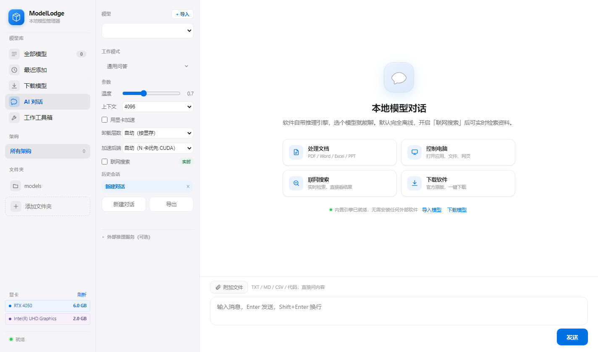
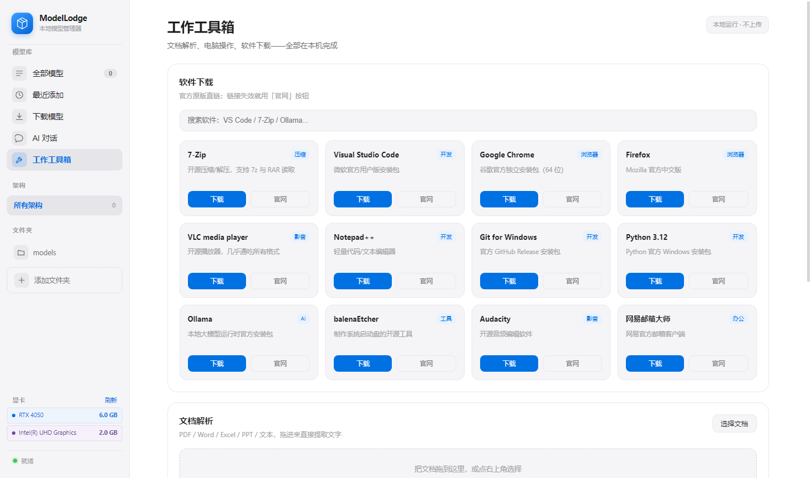
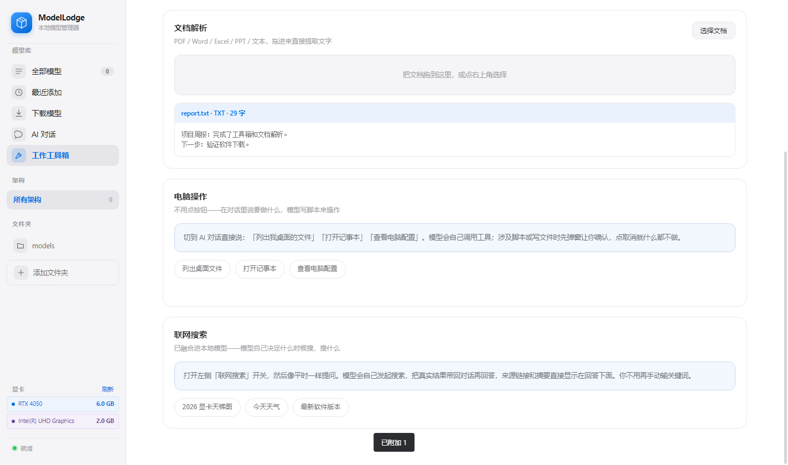
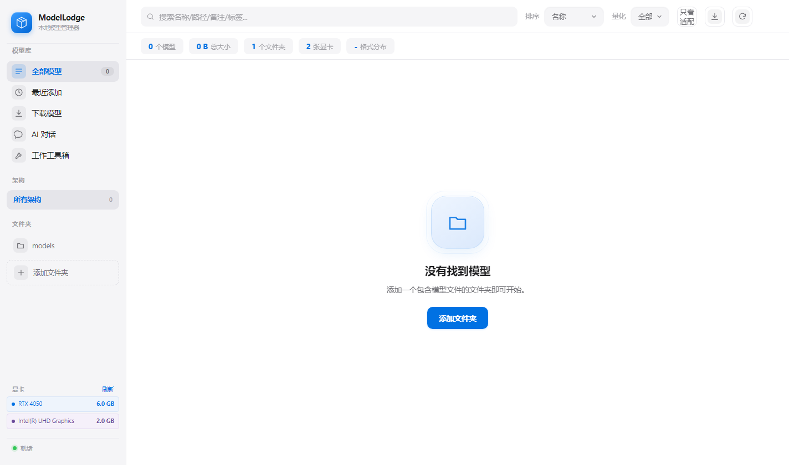
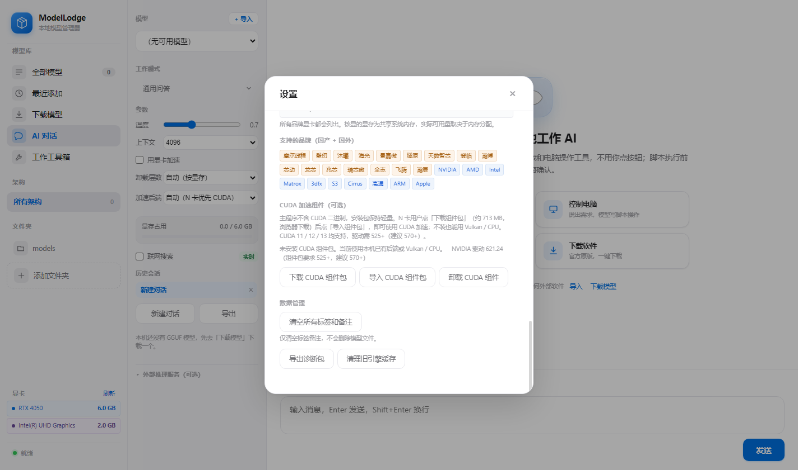
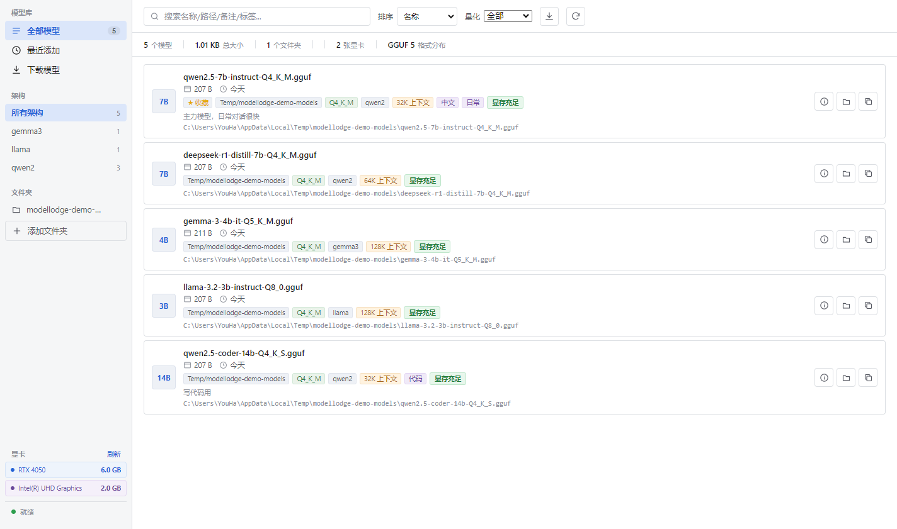
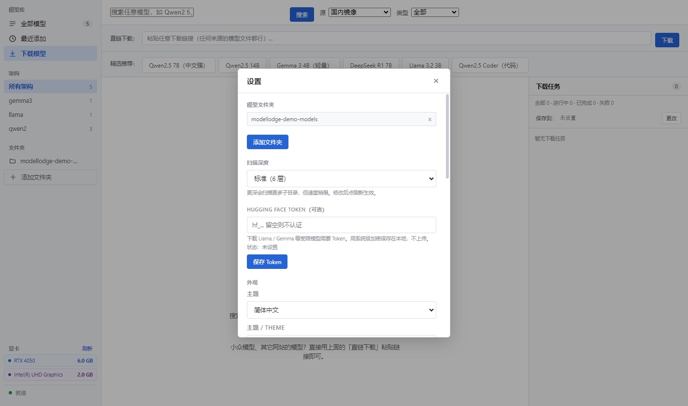

# ModelLodge

**本地模型管理器 + 能干活的本地 AI。** 下载、管理 GGUF 模型，直接在本机推理、读文档、联网查资料、用白名单脚本操作电脑。零遥测、默认离线、无需注册账号。

Windows x64 · Electron 28 · 内置 llama.cpp（CPU / Vulkan）；CUDA 为可选组件包，N 卡按需导入

---

## 界面

### AI 对话（内置引擎 / CUDA · Vulkan · CPU）



- 选个 GGUF 就加载并预热，不再等到第一次发消息才因显存不足失败
- 工作模式：总结 / 写作 / 翻译 / 代码审查 / 数据解读
- 按**实时空闲显存**自动算上下文与 GPU 卸载层数，也可手动选 0/25/50/75/99 层；选 0 层会明确传 `-ngl 0`，不会偷偷全卸载
- 显存不足时自动逐级降低层数 / 上下文重试，状态栏显示最终实际档位
- 实时显存占用条，接近上限时提示可能溢出到共享内存
- NVIDIA 显卡：导入「CUDA 组件包」后自动优先 CUDA（与本机 LM Studio 后端互斥，不会混用两套 DLL）；不装则用 Vulkan（提示通常比 CUDA 慢）。CUDA 11 / 12 / 13 都支持

### 工作工具箱





- 文档解析：PDF / Word / Excel / PPT / TXT / CSV，拖进去直接问内容；读取前弹窗确认
- 电脑操作：在对话里说需求，模型输出脚本，执行前弹窗让你确认；硬拦截格式化、删盘、关机
- 联网搜索：打开开关后模型自己决定何时搜，真实来源链接和摘要显示在回答下面（数据去向见下方「隐私与联网」）
- 软件下载：常用软件的官方原版直链，一键下载

### 模型浏览器



- 按名称/参数量搜索 HF / 魔搭，只看适配本机显存的量化版本
- 一键下载、断点续传，Gated 模型给出 Token 指引

### CUDA 组件包面板



- 下载 → 导入 → 卸载三步都在设置里；面板直接显示本机 NVIDIA 驱动版本与兼容性提示

### 模型库与设置




---

## 隐私与联网

**默认离线、零遥测**：软件本身不收集、不上传任何使用数据，没有统计 SDK、没有后台上报、没有账号系统。模型推理、文档解析、日志全部在本机完成；配置和日志只写 `%APPDATA%\modellodge\`。

**联网搜索是唯一主动出网的开关**，且默认关闭。只有你打开开关、并且模型判断需要实时资料时才会发请求：

- **发往哪里**：`cn.bing.com` / `www.bing.com`（国内优先）或 `html.duckduckgo.com`，仅此三个搜索端点，失败时依次回退，不走任何自有服务器。
- **发什么**：只有模型生成的**搜索关键词**（如「RTX 4050 驱动版本」）。不会上传你的对话全文、附加文件内容、剪贴板或本地路径。
- **护栏**：执行搜索前会硬校验关键词，一旦包含本地路径、文件名或疑似复制的文档片段，直接拒绝、不发请求；系统提示词也明确禁止把文件/剪贴板内容写进搜索词。
- **搜索结果**：标题/摘要/链接由搜索引擎返回，在本地拼进对话上下文给你看，来源链接直接显示，可自行核对。关掉开关后完全不再出网。

所以「零遥测」指的是**没有隐蔽的数据上报**；联网搜索是你主动开启、可随时关闭、内容可预期的显式行为，两者不冲突。

---

## 安装与校验

安装包：`ModelLodge-Setup-2.4.0.exe`（Windows x64，NSIS 安装向导，无需管理员权限）。

N 卡可选 CUDA：在「设置 → CUDA 加速组件」点「下载 CUDA 组件包」会打开 Release 下载页（资产 `ModelLodge-CUDA12-Component.zip`，约 713 MB），下完点「导入 CUDA 组件包」选该 zip 即可；不装也能用 Vulkan / CPU。发布时 `publish_github.py` 会把主包和 CUDA 组件包一起上传到同一个 Release。组件包含 CUDA 运行时，遵守 NVIDIA CUDA EULA，详见第三方声明。**驱动要求：525 以上（CUDA 12.8 建议 570+）；老驱动请留在 Vulkan / CPU，别只按新卡验证。** 组件包存在时会独占 CUDA 运行时路径，不再混入本机 LM Studio 的 vendor，避免加载到不同版本的 DLL。

```powershell
Get-FileHash "ModelLodge-Setup-2.4.0.exe" -Algorithm SHA256
```

个人开发者构建，**没有代码签名证书**。Windows SmartScreen 提示「未知发布者」属正常现象：核对 SHA256 一致后，点「更多信息」→「仍要运行」。当前构建不会上传任何数据；日志与配置只写本机 `%APPDATA%\modellodge\`，卸载时可选择一并清理。

遇到问题时：设置 → 数据管理 → **导出诊断包**，会在桌面生成 zip（只含日志和非敏感配置，不含 Token）。

---

## 文档

- [使用指南](GUIDE.md)
- [完整更新日志](CHANGELOG.md)
- [第三方组件致谢与引擎来源/校验值](THIRD_PARTY_NOTICES.md)
- [许可](LICENSE.rtf)

应用标识为 `com.modellodge.app`，为本项目的独立标识。
